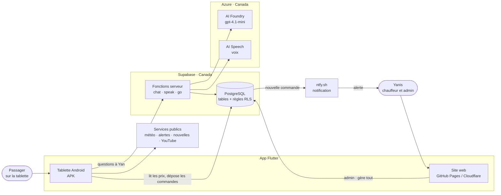
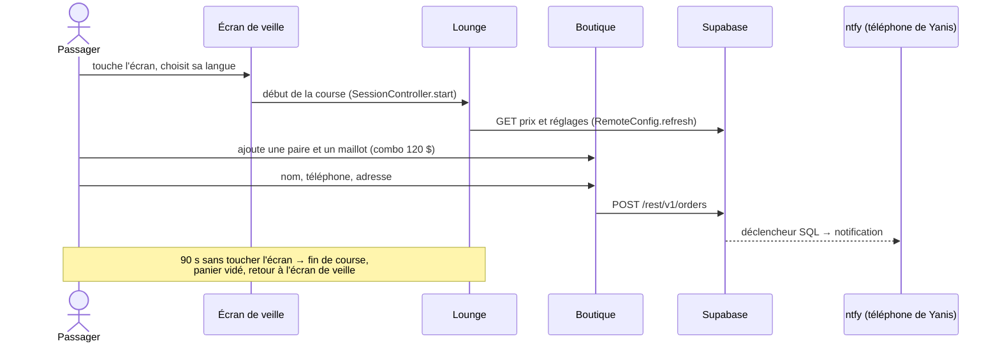

# 1. Architecture

## Le système en un schéma (niveau « contexte »)

Qui parle à qui. Les flèches sont des appels réseau (HTTPS).



**À retenir**
- L'app ne contient **aucun secret**. Elle ne connaît que la clé *publique*
  de Supabase ; ce sont les **règles de la base (RLS)** qui décident ce qu'elle
  a le droit de faire.
- Les clés d'Azure restent dans les **fonctions serveur** (`supabase/functions`) :
  l'app demande « réponds à cette question », la fonction appelle Azure.
- Tout ce qui touche aux personnes (commandes, questions) reste **au Canada**.

## Les « conteneurs » (au sens C4 : ce qui tourne séparément)

| Pièce | Technologie | Où elle tourne | Dossier |
|---|---|---|---|
| App passager + admin | Flutter (Dart), compilé en WebAssembly pour le web | Tablette, navigateur | `app/` |
| Base de données | PostgreSQL géré par Supabase | Supabase, région `ca-central-1` | `supabase/migrations/` |
| API de la base | PostgREST (fourni par Supabase) : chaque table devient une adresse REST | Supabase | — |
| Fonctions serveur | Deno (TypeScript) | Supabase Edge Functions | `supabase/functions/` |
| Modèle de langage, voix | Azure AI Foundry, Azure AI Speech | Azure, Canada | `infra/azure/` |
| Hébergement web | GitHub Pages et Cloudflare Workers | CDN | `.github/workflows/`, `wrangler.jsonc` |

## L'arborescence du dépôt

```text
ride-with-yan/
├── app/                      ← l'application Flutter
│   ├── lib/
│   │   ├── main.dart         ← point d'entrée : passager ou admin (?admin)
│   │   ├── app.dart          ← MaterialApp, thème, langue, navigation
│   │   ├── config.dart       ← adresses publiques (Supabase, WhatsApp…)
│   │   ├── backend/          ← tout ce qui parle au réseau
│   │   │   ├── backend.dart        ← « fetch » vers Supabase (http)
│   │   │   ├── remote_config.dart  ← prix et réglages venus de l'admin
│   │   │   └── usage.dart          ← statistiques anonymes
│   │   ├── data/             ← données et logique métier, sans interface
│   │   │   ├── store_catalog.dart  ← produits, panier, combo
│   │   │   ├── orders.dart         ← envoi d'une commande
│   │   │   ├── assistant.dart      ← conversation avec Yan
│   │   │   ├── alerts.dart         ← alertes météo
│   │   │   └── …                   ← météo, nouvelles, sondage, annonceurs
│   │   ├── screens/          ← un fichier par écran
│   │   ├── widgets/          ← briques d'interface réutilisables
│   │   ├── session/          ← la course en cours (langue, panier, minuterie)
│   │   ├── theme/            ← couleurs, polices, icônes
│   │   ├── navigation/       ← ouverture des sections
│   │   ├── l10n/             ← textes français / anglais
│   │   └── admin/            ← le panneau d'administration (chargé à part)
│   ├── test/                 ← tests Flutter
│   ├── assets/               ← photos, polices, vidéos
│   └── Dockerfile            ← construit l'app dans Docker, servie par nginx
├── supabase/
│   ├── migrations/           ← l'historique SQL de la base, dans l'ordre
│   └── functions/            ← chat (Yan), speak (voix), go (QR suivis)
├── infra/azure/              ← Terraform : services Azure
├── e2e/                      ← tests Playwright (navigateur + API)
├── labs/                     ← scripts Python de révision Azure AI
├── .github/workflows/        ← pipelines GitHub Actions
├── azure-pipelines.yml       ← le même pipeline sur Azure DevOps
├── docker-compose.yml        ← app + tests dans des conteneurs
├── wrangler.jsonc            ← hébergement Cloudflare
├── tools/                    ← scripts (photos, build Cloudflare)
├── showcase/                 ← sites de démonstration (section Collaborations)
└── video/                    ← vidéos de présentation (Remotion)
```

**La règle de rangement de `app/lib`** : plus on descend dans la liste
`screens → widgets → data → backend`, moins le code sait qu'il y a un écran.
`data/` et `backend/` ne connaissent pas Flutter-l'interface : c'est ce qui les
rend faciles à tester.

## Le trajet d'une course


