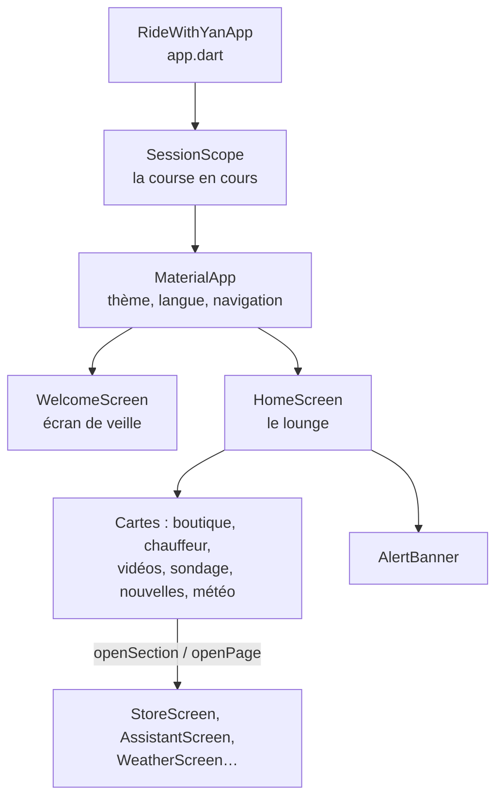
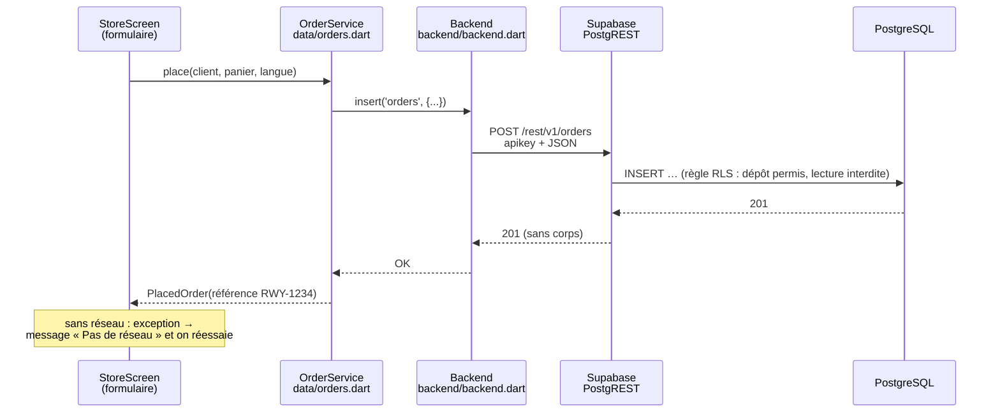

# 2. L'app Flutter

## Comment Flutter dessine un écran

En Flutter, **tout est un widget** : un bouton, un texte, une marge, un écran
entier. Un écran est un arbre de widgets ; quand une donnée change, Flutter
reconstruit la partie concernée de l'arbre.



Deux sortes de widgets :
- **`StatelessWidget`** : il affiche ce qu'on lui donne. Exemple : `_Bubble`
  (une bulle de conversation).
- **`StatefulWidget`** : il garde un état qui change. Exemple :
  `_AssistantScreenState` garde le champ de saisie.

## L'état : qui garde les données, et comment l'écran est prévenu

Pas de bibliothèque externe (Redux, Riverpod…) : l'app utilise ce que Flutter
fournit déjà.

| Outil Flutter | Rôle | Exemple dans l'app |
|---|---|---|
| `ChangeNotifier` | Un objet qui garde des données et crie « j'ai changé ! » (`notifyListeners()`) | `Cart` (panier), `RemoteConfig`, `AssistantController` |
| `ListenableBuilder` | Reconstruit un morceau d'écran quand l'objet crie | La liste des messages de Yan |
| `InheritedNotifier` | Rend un objet accessible à tous les écrans en dessous | `SessionScope.of(context)` donne la course en cours |
| Singleton `instance` | Un seul objet pour toute l'app | `RemoteConfig.instance`, `Usage.instance`, `YanVoice.instance` |

Exemple réel, simplifié (`data/store_catalog.dart`) :

```dart
class Cart extends ChangeNotifier {
  final Map<(String, String?), int> _lines = {};

  void add(Product p, [String? size]) {
    _lines[(p.id, size)] = quantityOf(p, size) + 1;
    notifyListeners();            // ← l'écran du panier se redessine
  }

  double get total => payNow + payLater;   // le combo est calculé ici
}
```

C'est l'équivalent d'un *store* en React : la logique est dans `Cart`,
l'écran ne fait qu'afficher.

## Les appels réseau : l'équivalent de `fetch` / Axios

Flutter n'a pas `fetch`. On utilise le paquet officiel **`http`**, très proche
de `fetch` : on construit une requête, on attend la réponse, on lit le JSON.

| JavaScript | Dart (Flutter) |
|---|---|
| `await fetch(url)` | `await http.get(Uri.parse(url))` |
| `await fetch(url, {method: 'POST', body: JSON.stringify(x)})` | `await http.post(Uri.parse(url), body: jsonEncode(x))` |
| `await res.json()` | `jsonDecode(response.body)` |
| `res.status` | `response.statusCode` |
| `async` / `await` / `Promise` | `async` / `await` / `Future` |

Tout passe par **un seul fichier**, `backend/backend.dart` : c'est notre
« client Axios ». Il ajoute les en-têtes, applique un délai maximal et
transforme les erreurs.

```dart
static Future<List<Map<String, dynamic>>> select(String table, {String? token}) async {
  final response = await http
      .get(
        Uri.parse('$_url/rest/v1/$table?select=*'),   // PostgREST
        headers: {
          'apikey': _key,                              // clé publique
          'Authorization': 'Bearer ${token ?? _key}',  // jeton admin si connecté
        },
      )
      .timeout(const Duration(seconds: 12));
  return (_read(response) as List).cast<Map<String, dynamic>>();
}
```

**Pourquoi pas le SDK Supabase ?** Supabase expose chaque table comme une
adresse REST (PostgREST). Quatre méthodes (`select`, `insert`, `update`,
`rpc`) suffisent : moins de dépendances, et on voit exactement ce qui part sur
le réseau.

### Exemple complet : une commande



Le code (`data/orders.dart`) :

```dart
await Backend.insert('orders', {
  'id': order.id,
  'reference': order.reference,
  'name': customer.name.trim(),
  'lines': orderLines(cart),
  'pay_now': cart.payNow,
  'pay_later': cart.payLater,
});
```

### Les autres sources de données

| Donnée | Source | Fichier |
|---|---|---|
| Météo | Open-Meteo (gratuit, sans clé) | `data/weather.dart` |
| Alertes | API d'Environnement Canada | `data/alerts.dart` |
| Nouvelles | Fils RSS Radio-Canada et CBC | `data/news.dart` |
| Yan | Notre fonction `chat` → Azure | `data/assistant.dart` |
| Voix de Yan | Notre fonction `speak` → Azure Speech | `data/yan_voice.dart` |

Règle commune : **une panne réseau ne casse jamais l'écran**. Chaque appel est
dans un `try/catch`, avec une valeur de secours ou un message clair.

## L'interface

| Élément | Où | Idée |
|---|---|---|
| Couleurs, polices | `theme/app_theme.dart` | Or (`Brand.gold`) sur fond sombre ou clair ; Cormorant pour les titres, Plus Jakarta Sans pour le texte |
| Palette par mode | `context.palette` | Mêmes noms de couleurs en mode clair et sombre (`p.text`, `p.glass`…) |
| Icônes | `theme/app_icons.dart` | Police Phosphor, réduite aux icônes utilisées |
| Verre dépoli, boutons | `widgets/glass.dart` | `LiquidPill`, `PillButton`, `GlowButton`, `Pressable` |
| Fond animé | `widgets/mesh_background.dart` | Un *shader* (programme exécuté par la carte graphique) |
| Animations décoratives | `widgets/decor_clock.dart` | **Une seule horloge** à 30 images/s pour toutes les animations : mesuré, c'est ce qui a doublé la fluidité |
| Cadre des sections | `widgets/section_scaffold.dart` | Retour, titre, mode clair/sombre, raccourcis |

**Bilingue** : deux façons, selon l'endroit.

```dart
// 1. Textes courts dans le code : la classe Bi (data/bilingual.dart)
const Bi('Demandez à Yan', 'Ask Yan').of(context)

// 2. Textes répétés : fichiers de traduction (l10n/app_fr.arb, app_en.arb)
AppLocalizations.of(context).storeSubtitle
```

## La navigation

- `navigation/sections.dart` : `openSection(context, Section.store)` ouvre une
  section du haut (Musique, Boutique, Publicité…).
- `openPage(context, const WeatherScreen(), name: 'weather')` ouvre un écran
  du lounge. Le `name` sert aussi aux statistiques.
- `session/session_controller.dart` : après 90 s sans toucher l'écran, la
  course se termine, le panier est vidé et l'app revient à l'écran de veille.

## Le panneau d'administration

`main.dart` regarde l'adresse : avec `?admin`, il lance `AdminApp`
(`admin/admin_app.dart`) au lieu de l'app passager. Ce code est **chargé à
part** (`deferred as admin`) : les passagers ne le téléchargent pas.
L'admin se connecte avec Supabase Auth ; son jeton est envoyé dans
`Authorization`, et les règles de la base le reconnaissent (`is_admin()`).
