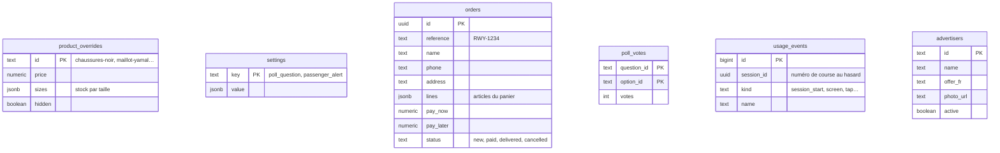

# 3. La base Supabase

Supabase, c'est **PostgreSQL** (une vraie base SQL) avec, par-dessus :
- **PostgREST** : chaque table devient une adresse web (`/rest/v1/orders`) ;
- **Auth** : les comptes (seul l'admin en a un) ;
- **Edge Functions** : de petits programmes serveur en TypeScript (Deno) ;
- **pg_cron** et **pg_net** : tâches planifiées et appels web depuis la base.

## Les tables



Le catalogue lui-même (noms, photos, tailles) est **dans l'app**
(`data/store_catalog.dart`). La base ne garde que ce que l'admin change :
prix, stock, articles masqués (`product_overrides`).

## La sécurité : les règles RLS

La clé de l'app est publique : n'importe qui peut l'extraire du site. La
protection vient donc de la base elle-même, avec la **Row Level Security**
(RLS) : chaque table dit qui peut lire, écrire, modifier, supprimer.

| Table | Passager (clé publique) | Admin (connecté) |
|---|---|---|
| `product_overrides`, `settings`, `advertisers` | lire | tout |
| `orders` | **déposer seulement** (ni lire, ni modifier) | tout |
| `usage_events` | déposer seulement | lire, supprimer |
| `poll_votes` | lire ; voter **seulement** via `cast_vote()` | supprimer |

Exemple réel (`supabase/migrations/20261007_orders_and_notifications.sql`) :

```sql
alter table public.orders enable row level security;

-- La tablette peut seulement déposer une commande neuve.
create policy "depot d'une commande" on public.orders
  for insert to anon, authenticated
  with check (status = 'new' and transfer_claimed = false);

-- Seul l'admin lit les commandes (données personnelles).
create policy "admin lit" on public.orders
  for select to authenticated using ((select public.is_admin()));
```

`is_admin()` vérifie que le compte connecté est bien
`yanisgaroui1@gmail.com`, avec un courriel confirmé.

Ces règles sont **testées automatiquement** : `e2e/tests/api/security.spec.ts`
joue le rôle d'un inconnu et vérifie que chaque tentative est refusée.

## Les fonctions SQL (appelées par `rpc`)

| Fonction | Rôle |
|---|---|
| `cast_vote(question, choice)` | Ajoute un vote, seulement pour une vraie question et une vraie réponse |
| `claim_transfer(id, référence)` | Le client indique « virement envoyé » |
| `usage_summary(since)` | Le résumé des statistiques pour l'admin |
| `chat_take_quota(session)` | Réserve une question à Yan (20 par passager, 400 par jour) |
| `notify_new_order()` | Déclencheur : envoie la notification ntfy à chaque commande |
| `apply_retention()` | Chaque nuit, efface les coordonnées après 12 mois |

## Les fonctions serveur (Edge Functions)

Elles servent quand l'app a besoin d'un **secret** (une clé Azure) ou d'une
logique qu'on ne veut pas confier au navigateur.

| Fonction | Appelée par | Ce qu'elle fait |
|---|---|---|
| `chat` | Écran de Yan | Vérifie le plafond, ajoute les consignes de Yan, appelle gpt-4.1-mini sur Azure |
| `speak` | Bouton 🔊 | Transforme la réponse en voix avec Azure Speech |
| `go` | QR codes des annonceurs | Compte le scan, puis redirige vers le site du commerce |

Déployer une fonction :

```bash
npx supabase functions deploy chat --project-ref jwwftxjbswpwtbkluslz --no-verify-jwt --use-api
npx supabase secrets set --project-ref jwwftxjbswpwtbkluslz --env-file secrets.env
```

## Les migrations : l'historique de la base

Chaque changement de la base est un fichier SQL daté dans
`supabase/migrations/`, appliqué dans l'ordre. C'est le « Git de la base » :
on sait toujours pourquoi et quand une table a changé.

| Fichier | Contenu |
|---|---|
| `20261004_ride_with_yan_admin.sql` | Produits, réglages, sondage, `is_admin()` |
| `20261007_orders_and_notifications.sql` | Commandes et notification |
| `20261011_poll_allow_list.sql` | Votes limités aux vraies réponses |
| `20261014_retention.sql` | Conservation des données (Loi 25) |
| `20261014_usage_events.sql` | Statistiques anonymes |
| `20261017_chat_quota.sql` | Plafonds de Yan |
| `20261019_advertisers.sql` | Annonceurs |
