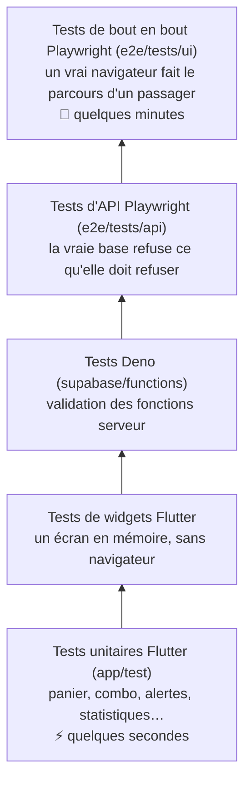

# 4. Les tests

## La pyramide

Beaucoup de petits tests rapides en bas, quelques gros tests réalistes en haut.



| Niveau | Outil | Nombre | Lancer |
|---|---|---|---|
| Unitaires et widgets | `flutter_test` | ~66 | `cd app && flutter test` |
| Fonctions serveur | `deno test` | ~8 | `cd supabase/functions && deno test` |
| API (sécurité de la base) | Playwright | ~30 | `cd e2e && npx playwright test --project=api` |
| Écrans (bout en bout) | Playwright | ~35 | `cd e2e && npx playwright test --project=ui-chromium` |
| Accessibilité | Playwright + axe-core | 3 écrans | inclus dans les tests d'écrans |

## 1. Un test unitaire (Dart)

On teste la logique pure, sans écran (`app/test/store_test.dart`) :

```dart
test('une paire et un maillot reviennent à 120 \$', () {
  final cart = Cart()
    ..add(_find('chaussures-blanc'), 'US 9')
    ..add(_find('maillot-yamal'), 'M');

  expect(cart.combos, 1);
  expect(cart.total, comboPrice);   // 120
});
```

Structure classique **Arrange / Act / Assert** : on prépare, on agit, on
vérifie.

## 2. Un test de widget

Flutter dessine un écran en mémoire et on « touche » des boutons
(`app/test/admin_test.dart`) :

```dart
await tester.tap(find.text('Sondage et message'));
await tester.pumpAndSettle();                 // attendre la fin des animations
expect(find.text('Message aux passagers'), findsOneWidget);
```

Règle importante : `Backend.offline = true` dans les tests, pour **ne jamais
écrire dans la vraie base**.

## 3. Un test de bout en bout (Playwright)

Un vrai navigateur ouvre l'app et fait le parcours d'un passager. Le code est
organisé en **Page Objects** : une classe par écran qui cache les détails
techniques (`e2e/src/pages/store-page.ts`).

```ts
test('une paire avec un maillot revient à 120 $ (combo)', async ({ store }) => {
  await store.showCategory('Shoes');
  await store.addSized('All white', 'US 9');
  await store.showCategory('Jerseys');
  await store.addSized('Yamal jersey', 'M');

  await expect(store.comboLine).toBeVisible();
  await expect(store.amount('$120')).toBeVisible();
});
```

### Comment Playwright « voit » une app Flutter

Flutter dessine sur un *canvas* : il n'y a pas de vrais boutons HTML. L'adresse
`?e2e` demande à Flutter de créer, en plus, une couche d'**accessibilité**
(des éléments invisibles avec un rôle et un nom). Playwright les trouve comme
un lecteur d'écran : `getByRole('button', { name: 'Demandez à Yan' })`.

### La fausse base (`e2e/src/fixtures.ts`)

Toutes les requêtes vers Supabase sont **interceptées** avec
`page.route(...)`. Le test décide de la réponse (une commande réussit, le
réseau tombe, Yan répond « … ») et vérifie ce que l'app a envoyé :

```ts
await page.route('**/*.supabase.co/**', async (route) => {
  if (isOrder(route.request())) {
    this.orders.push(route.request().postDataJSON());   // on garde la commande
    return route.fulfill({ status: 201, body: '' });
  }
  …
});
```

## 4. Un test d'API (sécurité)

Ici on parle à la **vraie** base, mais seulement avec des tentatives qui
doivent échouer (`e2e/tests/api/security.spec.ts`) :

```ts
test('un visiteur ne peut pas lire les commandes', async ({ request }) => {
  const response = await new SupabaseAnon(request).read('orders');
  expect(await response.json()).toEqual([]);   // la règle RLS cache tout
});
```

Les réponses sont validées par des **schémas Zod** : si la forme d'une donnée
change, le test le dit.

## 5. Accessibilité

`e2e/tests/ui/accessibility.spec.ts` lance **axe-core** sur trois écrans et
refuse toute erreur grave (bouton sans nom, image sans description…). Ce test
a trouvé 12 boutons muets et 18 images non décrites : tous corrigés.

## Les pièges rencontrés (utile en entrevue)

| Problème | Solution |
|---|---|
| Sur une machine lente, la première lettre tapée se perdait | Taper touche par touche, vérifier la valeur, recommencer au besoin |
| « Tap to start » disparaît pendant la vitrine de 15 s | Vérifier le bouton rouge, présent sur toutes les diapos |
| Le conteneur nginx semblait « malade » | `localhost` pointait vers l'IPv6 : utiliser `127.0.0.1` |
| Un bouton annoncé ne réagissait pas | Déclarer l'action `onTap` sur la description d'accessibilité |
