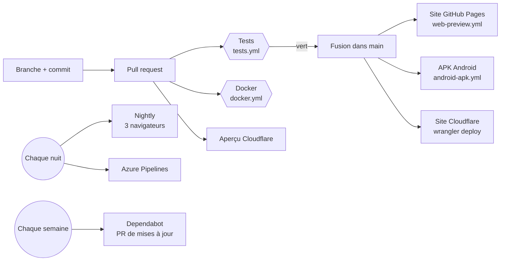

# 5. CI/CD : ce qui se passe automatiquement

**CI** (intégration continue) : à chaque changement, des robots vérifient le
code. **CD** (déploiement continu) : si tout est vert, ils publient l'app.



## Les pipelines

| Fichier | Quand | Étapes |
|---|---|---|
| `.github/workflows/tests.yml` | Chaque PR et chaque push sur `main` | Format → analyse → tests Flutter → build web → **budget de 4 Mo** → tests Deno → types, lint, tests Playwright |
| `.github/workflows/docker.yml` | PR qui touche les tests ou Docker | Construit l'app dans Docker (Flutter → nginx) et lance les tests dans un conteneur |
| `.github/workflows/nightly.yml` | Chaque nuit, 3 h à Ottawa | Toute la suite sur Chrome, Firefox et WebKit, répartie sur 3 machines, plus un contrôle du site en ligne |
| `.github/workflows/web-preview.yml` | Push sur `main` | Publie le site sur GitHub Pages |
| `.github/workflows/android-apk.yml` | Push sur `main` qui touche `app/` | Construit l'APK et le publie dans les *Releases* |
| `azure-pipelines.yml` | Chaque nuit, sur Azure DevOps | La même chaîne, avec résultats JUnit |
| `.github/dependabot.yml` | Chaque semaine | Ouvre une PR par mise à jour (sans version majeure automatique) |
| Cloudflare (`wrangler.jsonc`) | Push sur `main`, et chaque PR | `bash tools/cloudflare-pages-build.sh` puis `npx wrangler deploy` |

## Lire un fichier de workflow

```yaml
on:
  pull_request:            # QUAND le pipeline démarre
    branches: [main]

jobs:
  app:                     # un « job » = une machine neuve
    runs-on: ubuntu-24.04
    steps:                 # les étapes, dans l'ordre
      - uses: actions/checkout@v7          # récupérer le code
      - uses: subosito/flutter-action@v2   # installer Flutter
      - run: flutter test                  # lancer une commande
```

- `uses:` reprend une action toute faite (comme une fonction d'une librairie).
- `run:` exécute une commande shell.
- `needs: app` : ce job attend la fin du job `app`.
- Les **artefacts** (`upload-artifact`) passent un fichier d'un job à
  l'autre, par exemple l'app construite vers les tests.

## La protection de `main`

Le travail passe toujours par une **branche** et une **pull request** : les
tests tournent sur la PR, on ne fusionne que si c'est vert. La PR #9
(TypeScript 7) a été bloquée de cette façon : elle aurait cassé le code.
