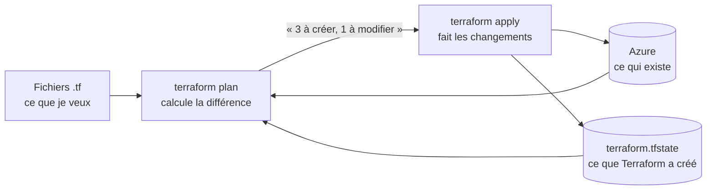

# 6. Terraform : l'infrastructure en code

## L'idée

Au lieu de **cliquer** dans le portail Azure pour créer une ressource, on la
**décrit** dans un fichier. Terraform compare la description avec ce qui
existe vraiment dans Azure, et fait seulement les différences.



Pourquoi c'est mieux que cliquer :
- **On relit** : chaque changement passe par une PR, avec son explication.
- **On recrée** tout en une commande, dans une autre région ou un autre compte.
- **On voit** exactement ce qui existe, au lieu de fouiller le portail.
- **On supprime** tout proprement : `terraform destroy`.

## Nos fichiers (`infra/azure/`)

| Fichier | Rôle |
|---|---|
| `providers.tf` | Quel « fournisseur » utiliser (`azurerm` pour Azure), et quel abonnement |
| `variables.tf` | Les réglages qu'on peut changer : région, modèle, débit… |
| `main.tf` | Le groupe de ressources, la ressource Foundry, le modèle de Yan |
| `ai-services.tf` | Les services gratuits du laboratoire (Speech, Translator…) et AI Search |
| `outputs.tf` | Ce qu'on veut lire après : adresses et clés (marquées *sensitive*) |
| `ride.tfvars` | **Tes** valeurs (abonnement, modèle). **Pas dans Git** |
| `terraform.tfstate` | La mémoire de Terraform. Contient des clés : **jamais dans Git** |
| `.terraform.lock.hcl` | Les versions exactes du fournisseur (dans Git, comme un `package-lock.json`) |

## Lire un bloc Terraform

```hcl
resource "azurerm_cognitive_account" "foundry" {   # type de ressource + nom interne
  name                  = "ai-${var.name}"           # nom dans Azure : ai-ride-with-yan
  location              = azurerm_resource_group.ride.location   # ← référence à une autre ressource
  resource_group_name   = azurerm_resource_group.ride.name
  kind                  = "AIServices"               # le type de service d'IA
  sku_name              = "S0"                        # le niveau de prix
  custom_subdomain_name = "ai-${var.name}"           # l'adresse : ai-ride-with-yan.cognitiveservices.azure.com
}
```

- `resource "TYPE" "NOM"` : `NOM` sert seulement dans le code
  (`azurerm_cognitive_account.foundry.endpoint`).
- `var.name` : une variable de `variables.tf`.
- Écrire `azurerm_resource_group.ride.location` crée une **dépendance** :
  Terraform crée le groupe d'abord, tout seul.

### Une boucle : 6 services en un bloc

```hcl
locals {
  ai_services = {
    speech     = "SpeechServices"
    translator = "TextTranslation"
    language   = "TextAnalytics"
    vision     = "ComputerVision"
    documents  = "FormRecognizer"
    safety     = "ContentSafety"
  }
}

resource "azurerm_cognitive_account" "lab" {
  for_each = local.ai_services          # une ressource par ligne
  name     = "${each.key}-${var.name}"  # speech-ride-with-yan, translator-…
  kind     = each.value
  sku_name = "F0"                       # niveau gratuit
  …
}
```

## Les commandes, dans l'ordre

```bash
az login                                      # 1. se connecter à Azure
cd infra/azure
terraform init                                # 2. télécharger le fournisseur azurerm
terraform validate                            # 3. vérifier la syntaxe
terraform plan  -var-file=ride.tfvars -out=plan.tfplan   # 4. voir ce qui va changer
terraform apply plan.tfplan                   # 5. appliquer exactement ce plan
terraform output endpoint                     # 6. lire une sortie
terraform output -raw api_key                 #    (une clé : à ne pas afficher en public)
terraform state list                          # 7. ce que Terraform gère
terraform destroy -var-file=ride.tfvars       # tout supprimer
```

## Portail Azure ↔ Terraform : la même chose, deux façons

| Dans le portail Azure (clics) | En Terraform (code) |
|---|---|
| **Groupes de ressources** → Créer → nom `rg-ride-with-yan`, région Canada Est | `resource "azurerm_resource_group" "ride"` |
| **Azure AI Foundry** → Créer une ressource → type *AI Services*, niveau S0 | `resource "azurerm_cognitive_account" "foundry"` avec `kind = "AIServices"` |
| Dans **Foundry** → Modèles + points de terminaison → Déployer `gpt-4.1-mini` → type *Standard*, débit 30 k | `resource "azurerm_cognitive_deployment" "assistant"` avec `capacity = 30` |
| **Speech service** → Créer → niveau *Free F0* | Ligne `speech = "SpeechServices"` + `sku_name = "F0"` |
| **AI Search** → Créer → niveau *Free* | `resource "azurerm_search_service" "lab"` avec `sku = "free"` |
| Ressource → **Clés et point de terminaison** → copier la clé | `terraform output -raw api_key` |
| Modifier le débit dans le portail | Changer `capacity`, puis `plan` et `apply` |

## Ce qu'on a vécu (et qu'on rencontre en entreprise)

1. **Changer une valeur** : le débit de Yan, de 10 à 30. `plan` a montré
   `~ capacity = 10 -> 30` (`~` = modification sur place), puis `apply`.
2. **Une création coupée en route** : trois services ont été créés dans Azure,
   mais Terraform a été interrompu avant de les noter. Résultat : « already
   exists ». Solution : **`terraform import`**, qui dit à Terraform « cette
   ressource existe déjà, c'est la tienne ». Ensuite, `plan` a répondu
   *No changes*.
3. **Les secrets** : les clés sont lues par `terraform output` et versées
   directement dans les secrets Supabase ou `labs/.env`, sans jamais
   s'afficher.

## Exercice pour toi

1. Dans `variables.tf`, change la valeur par défaut de `capacity` de 30 à 20.
2. Lance `terraform plan -var-file=ride.tfvars`. Que dit-il ?
   *(Indice : `ride.tfvars` fixe déjà `capacity = 30`, donc la valeur du
   fichier gagne : « No changes ». C'est l'ordre de priorité des variables.)*
3. Remets 30.
