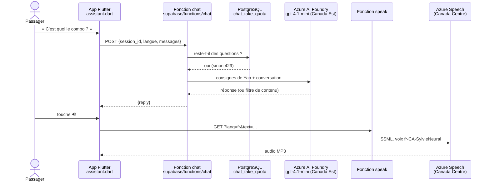

# 7. Azure AI Foundry : Yan, la voix et les labs

## Comment Yan répond



- **Les consignes de Yan** (le *system prompt*) sont dans
  `supabase/functions/chat/prompt.ts` : prix, combo, livraison, services,
  règles (80 mots, jamais de données personnelles, 911 en cas d'urgence).
- **La clé** ne quitte jamais le serveur : l'app ne parle qu'à nos fonctions.
- **Les garde-fous** : 20 questions par passager, 400 par jour, et les filtres
  de contenu d'Azure (une tentative de détournement est refusée).

## Les ressources dans Azure

| Ressource | Type (`kind`) | Niveau | Sert à |
|---|---|---|---|
| `ai-ride-with-yan` | AIServices (Foundry) | S0, payé à l'usage | Le modèle de Yan |
| `speech-ride-with-yan` | SpeechServices | F0, gratuit | La voix de Yan, lab 1 |
| `translator-ride-with-yan` | TextTranslation | F0 | Traduction (à venir) |
| `language-ride-with-yan` | TextAnalytics | F0 | Avis, sentiment (à venir) |
| `vision-ride-with-yan` | ComputerVision | F0 | OCR (à venir) |
| `documents-ride-with-yan` | FormRecognizer | F0 | Factures (à venir) |
| `safety-ride-with-yan` | ContentSafety | F0 | Modération (à venir) |
| `search-ride-with-yan` | AI Search | Free | RAG (à venir) |

## À toi de jouer : refaire dans le portail ce que Terraform a fait

Le meilleur moyen de comprendre l'examen : **voir la même chose des deux
côtés**. Ces étapes ne créent rien, elles font regarder.

### 1. Voir le modèle de Yan dans Foundry
1. Ouvre https://ai.azure.com et connecte-toi (`yanisgarwi@hotmail.com`).
2. Choisis la ressource **ai-ride-with-yan**.
3. Menu **Modèles + points de terminaison** : tu vois le déploiement
   **assistant** (gpt-4.1-mini, type Standard, 30 k jetons par minute).
   → C'est le bloc `azurerm_cognitive_deployment "assistant"` de `main.tf`.
4. Ouvre le **Terrain de jeu de conversation** (*Chat playground*), colle le
   contenu de `prompt.ts` dans les instructions système, et pose une question
   à Yan. C'est exactement ce que fait notre fonction `chat`.
5. Clique **Afficher le code** : le portail te montre le code Python
   équivalent. Compare-le avec `supabase/functions/chat/index.ts`.

### 2. Voir la voix dans Speech Studio
1. Ouvre https://speech.microsoft.com et choisis la ressource
   **speech-ride-with-yan**.
2. **Galerie de voix** : écoute `fr-CA-SylvieNeural`.
3. **Création de contenu audio** : écris une phrase de Yan et écoute-la.
   → C'est ce que font `labs/01-speech/parler.py` et la fonction `speak`.

### 3. Voir les clés (sans les copier ailleurs)
Portail Azure → ressource → **Clés et point de terminaison**. Ce sont les
valeurs que Terraform lit avec `terraform output`.

## Les labs Python (`labs/`)

Un script par service, écrit comme les extraits de code de l'examen :
paquet → client → appel → vérification du résultat.

```bash
cd labs
.venv\Scripts\python cles.py --depuis-terraform        # remplit .env (une fois)
.venv\Scripts\python 01-speech\parler.py "Bonjour !"   # crée reponse.wav
.venv\Scripts\python 01-speech\parler.py --ecouter reponse.wav
```

Le motif à reconnaître à l'examen (Speech) :

```python
speech_config = speechsdk.SpeechConfig(subscription=CLÉ, region=RÉGION)  # région, pas l'adresse
speech_config.speech_synthesis_voice_name = "fr-CA-SylvieNeural"
audio = speechsdk.audio.AudioOutputConfig(filename="reponse.wav")
synthese = speechsdk.SpeechSynthesizer(speech_config=speech_config, audio_config=audio)
resultat = synthese.speak_text_async("Bonjour").get()
if resultat.reason == speechsdk.ResultReason.SynthesizingAudioCompleted: ...
```

## La suite prévue (dans l'ordre du programme AI-901)

| Service | Dans l'app | Lab |
|---|---|---|
| Translator | Bouton « Traduire en anglais » pour les annonceurs | `02-translator` |
| Language | « Laissez un avis » : sentiment, données personnelles masquées | `03-language` |
| Vision (OCR) | Photo de la carte d'un commerce → fiche remplie | `04-vision` |
| Document Intelligence | Lire une facture fournisseur | `05-documents` |
| AI Search (RAG) | Yan répond à partir d'une base de connaissances | `06-rag` |
| Content Safety | Modérer les avis et les annonces | `07-safety` |
| Agent avec outils (AI-103) | Yan consulte les vrais prix et la météo | `08-agent` |
